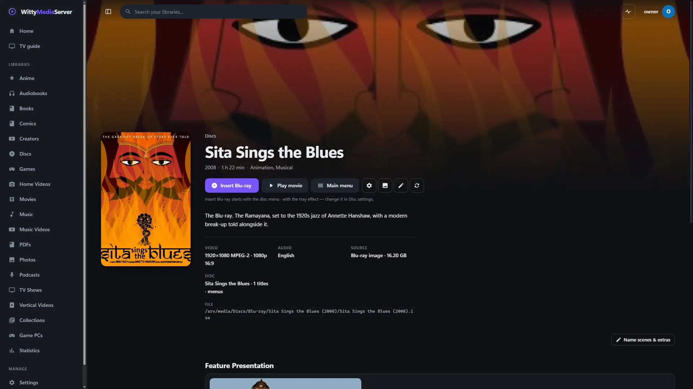
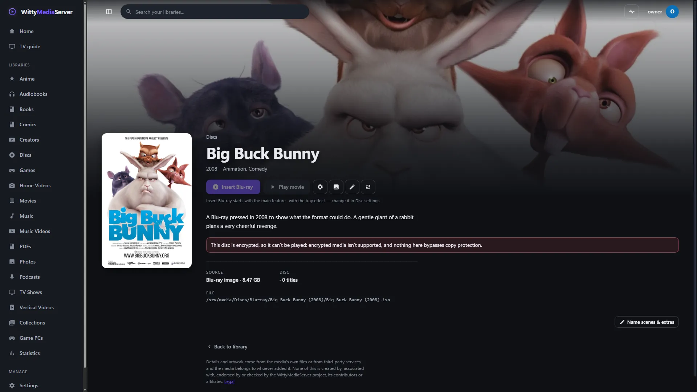

# WittyBluray

Plays Blu-ray images and `BDMV` folders in WittyMediaServer the way a player does, with their menus, including 4K, HDR and 3D discs. You need it if your disc libraries hold Blu-rays.

<!-- pictures -->


<sub>A Blu-ray image, in a browser. [Sita Sings the Blues](https://archive.org/details/SitaSingsTheBlues_201812), Nina Paley, [CC0](https://creativecommons.org/publicdomain/zero/1.0/).</sub>



<sub>A disc's page in WittyMediaServer. [Sita Sings the Blues](https://archive.org/details/SitaSingsTheBlues_201812), Nina Paley, [CC0](https://creativecommons.org/publicdomain/zero/1.0/).</sub>



<sub>An encrypted pressing gets a plain message, and nothing unlocks it. [Big Buck Bunny](https://peach.blender.org/), Blender Foundation, [CC BY 3.0](https://creativecommons.org/licenses/by/3.0/), from a disc pressed by Imagion AG.</sub>

<!-- /pictures -->

## What it does

- **Plays the disc's own program:** first play, titles, interactive and pop-up menus with animated highlights, chapters and the navigation timer, through a virtual machine for the disc's commands.
- **Reads without mounting:** `.iso` and `.img` images and `BDMV` folders, through WittyDisc.
- **4K and HDR:** it reads 2160p HEVC streams with their HDR10, HDR10+ and Dolby Vision flags, so a player can choose what to do on an SDR screen.
- **Subtitles** from the disc's presentation graphics, read in windows so a large film is never scanned whole.
- **Java (BD-J) menus,** only if you install a Java and turn this on. None is shipped. They run in a default-deny sandbox, and without Java the disc plays its titles.
- **Refuses encrypted discs.** AACS-encrypted discs are refused and BD+ is not run. Nothing is decrypted. The server makes its own check as well, whatever a module says.
- **Tells you what's on a disc.** The `wittybluray` command-line tool reports all of this, simulates the menus and draws menu pages.

It doesn't do these yet:

| Not yet | What happens instead |
|---|---|
| Secondary audio, picture in picture | The disc's choice is recorded, not mixed in |
| The second view of a 3D disc | The 2D view plays, and the second view is reported |

Drawing menus into pictures, and the session code that turns steps into streams, stay with the server.

How to use it is in **Help** inside WittyMediaServer: see Blu-rays.

## How to get it

An admin adds it from the module store inside WittyMediaServer: **Settings → Modules**, then **Browse the store**, then **Add** beside WittyBluray. That needs WittyMediaServer 0.6.0-alpha or later, and it works with nothing older. The range this version fits is in `module.json`: 0.6.0-alpha through 0.6.x.

## What it needs

- FFmpeg, which comes with the server.
- Java 8 or newer on the server, only for discs with Java menus, and only if you turn that on.
- [WittyDisc](https://github.com/wittywilla/WittyDisc), which reads the images, and [WittyModule](https://github.com/wittywilla/WittyModule), which is how a server talks to it. Both are built in.
- No media comes with it.

It's written in Go with no cgo, from the published disc structure.

## Platforms

It has only been tested on custom-authored discs, so retail discs may show problems not seen yet.

A program is built for each system below, and the server uses the right one.

| System | Where it stands |
|---|---|
| Linux (x64, arm64, 32-bit ARM, x86) | Its tests pass on x64, and a Blu-ray playlist has played from a test server with it installed, checked by script. The other CPUs are only built |
| Windows (x64, arm64) | Built. This version hasn't been run on Windows since it became its own program |
| macOS (Intel, Apple silicon) | Built by the release tool. It has not been run on a real Mac |
| FreeBSD (amd64, arm64) | Cross-compiled only. It has not been run |

On macOS and FreeBSD the server has no sandbox for a module's helper: it gets a small environment and a soft memory limit, and nothing more.

## Building and testing

You need Go 1.26 or newer. In a worktree, first run the copy of `dev-modules.mjs` kept above the repositories (`node D:/projects/dev-modules.mjs` on the development machine). It writes a `go.work` that git ignores, so the checkout builds against the repositories beside it. Never run `go work use`.

```bash
go vet ./...
```

```bash
go test ./... -count=1
```

```bash
go run github.com/wittywilla/wittymodule/cmd/wittymodule check .
```

The last one checks the manifest. On the same tool, `pack -targets linux/amd64 -out release .` builds a release for one system. CI also builds for every system.

The tests run disc code in Java, and skip where there's no Java. `WMS_REQUIRE_JAVA=1` makes a skip a failure, as CI does. `bdj/runtime.jar` is built by `bdj/java/build.sh`, which needs a JDK 11 or newer. You only need that to change the runtime.

To look at a disc by hand:

```bash
go run ./cmd/wittybluray info MY_DISC.iso
```

| Command | What it shows |
|---|---|
| `wittybluray info <disc>` | Titles, the disc's program, playlists, clips and streams, 3D and HDR flags |
| `wittybluray playlist <disc> <n>` | Every item, stream and chapter of one playlist |
| `wittybluray menu <disc> <playlist>` | A playlist's menu: pages, buttons, every command |
| `wittybluray walk <disc> [button...]` | Simulates inserting the disc, then pressing menu buttons by id |
| `wittybluray render <disc> <dir>` | The first menu's pages as PNG files |
| `wittybluray bdj <disc> [seconds [picture.png [key...]]]` | Java titles and what their code needs; with Java, runs them, pressing the keys named |

To use it as a library, `wittybluray.Open` opens an image or folder, and `wittybluray.NewNav` gives a navigator: `Start`, `PressButton`, `PlaylistEnded` and the rest return what to do next. Check `d.Encrypted` first.

`wittyblurayplayer/` is the same engine as a program of its own for WittyMediaPlayer, with its own `go.mod` and manifest.

## Licence

GNU Affero General Public License v3.0 (or later): see [LICENSE](LICENSE) and [NOTICE](NOTICE). If you redistribute it or build on it, please keep the NOTICE attribution. It's an original implementation and contains no code from other players. `bdj/runtime.jar` is original code that re-implements the published interfaces disc applications link against, and contains no Java runtime. Each release archive carries a `THIRD-PARTY-NOTICES.txt` for what its programs link.

## Legal

WittyBluray is an independent open-source project. It isn't associated with, sponsored by or
endorsed by the Blu-ray Disc Association, any film studio or any other player project. “Blu-ray” and
“Blu-ray Disc” are trademarks of the Blu-ray Disc Association; WittyBluray isn't a licensed or
certified Blu-ray product and uses no Blu-ray logo. AACS-encrypted discs are refused, BD+ isn't run,
nothing is decrypted, and no media comes with it: you're responsible for having the rights to what
you open. Any third-party names here only describe what it works with, and belong to their owners.
It's provided “as is”, with no warranty; see [LICENSE](LICENSE). Local law applies to how you use
it. This isn't legal advice.

<!-- module-kit -->
## Releasing

A version tag builds a program for every platform, signs the checksum list, and publishes a release that servers can install.

Versions move in small steps as work lands. `go run github.com/wittywilla/wittymodule/cmd/wittymodule@v0.3.0 bump .` raises it
everywhere it is written (add `-part minor` for a bigger step). A bump isn't a release: nothing is
tagged or published until you tag it. CI fails when code changed since the last tag and the version
didn't, because tags never move.

To release:

1. Check that `version` in `module.json` is the one to publish, with the bump committed.
2. Tag that commit and push the tag: `git tag vX.Y.Z`, then `git push origin vX.Y.Z`. A tag with a
   suffix, such as `v1.2.0-beta`, is published as a prerelease.
3. Watch the *Actions* tab. The signing step uses the `WMS_SIGNING_KEY` secret of the `release` environment, and nothing is published without it.

To take a version back, run the *withdraw* workflow from the *Actions* tab. It adds the version to a signed list on the release tagged `withdrawals`, which servers read.

Licensed under AGPL-3.0-or-later: see [LICENSE](LICENSE) and [NOTICE](NOTICE).
<!-- /module-kit -->
